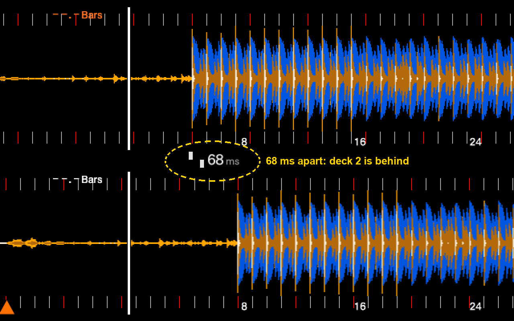
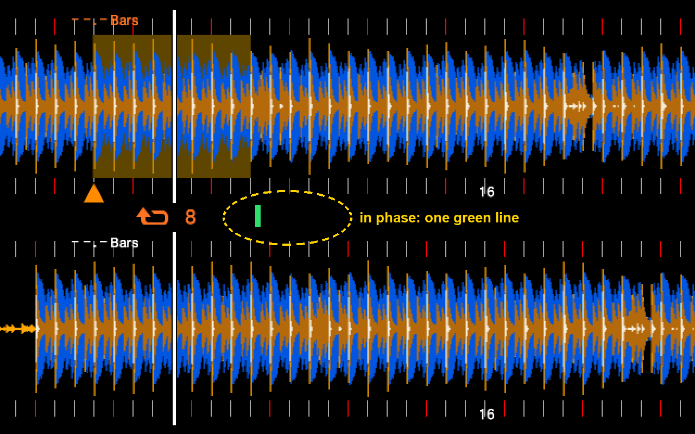
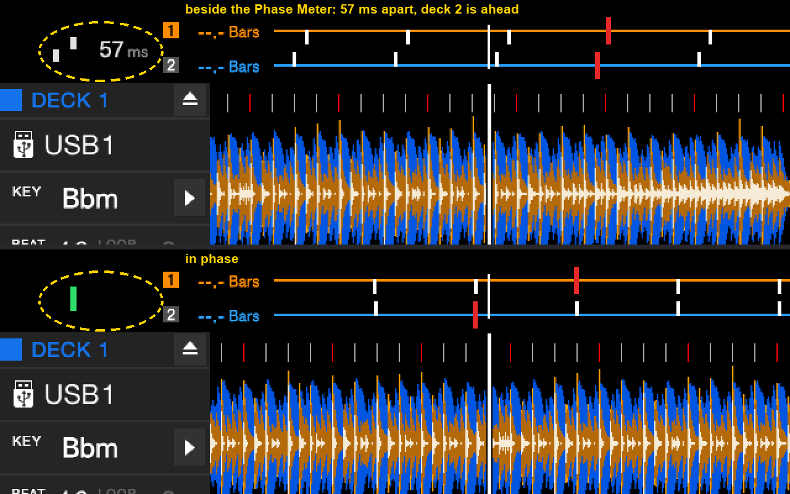

# Nudge Indicator

**Beatmatching by hand? See the last few milliseconds.**

An [AZ-MODS](https://github.com/Kyle-Hosman/xdj-az-mods) community mod for the XDJ-AZ.

While decks 1 and 2 play at the same tempo, a small sign on the 2 DECK waveform view shows how far
apart their beats are:

- **Two ticks.** The upper one is deck 1 and stays put. The lower one is deck 2: it sits to the
  right when deck 2 is behind, to the left when it is ahead, 1 px per millisecond (up to 14 px).
- **A number.** The difference in milliseconds.
- **A green line.** Nudge until the ticks meet. When the beats are within 5 ms of each other for a
  quarter of a second, the sign turns into one green line: the beats are where Sync would put them.

The line stays up to 5 ms and through a brief jump in the reading; it goes when the beats stay
more than 5 ms apart for a third of a second, or at once past 10 ms.

## It reads the beat grids

The sign compares the two tracks' **beat grids**, exactly what Sync works from. It does not listen
to the music. So it is only as accurate as the rekordbox analysis of both tracks:

- with good grids, the green line means the beats are together;
- where a grid is off (a wrong first beat, a drifting tempo, a live drummer), the line can show
  while the beats are audibly apart, the same way Sync would land them wrong.

Trust your ears first; fix the grid in rekordbox if the sign and your ears disagree.

## With the Phase Meter

The sign works with or without the core's Phase Meter. With the Phase Meter on, it moves beside
the meter's rulers by itself: the meter shows the picture, Nudge Indicator the number.

## When it shows

- on the 2 DECK waveform view, themes off, decks 3 and 4 empty;
- both decks loaded and playing, with a beat grid;
- the two tempos within 0.2 % of each other. A mismatch hides the sign after 2 seconds, so a jog
  nudge does not blink it away.

It compares beats, not bars, as Sync does.

## Mod Menu

- **Nudge Indicator**: on or off.
- **Status**: what the mod sees, live: each deck's state, tempo and beat phase, the difference,
  and why the decks are not in phase.

## Safe by design

Display only. It reads the decks' beat phase and tempo through the core's services and draws one
small box. No hooks, no files, no network, no threads of its own, and it never touches a button,
a knob or the audio.

The pictures are 2x enlargements of the deck program's own screen.

## Build and test

`make unit` and `make unit-tsan` run the unit tests on a computer (clang); `make test` runs the
SDK's harness; `azmod-pack build .` builds the mod for the deck. The SDK is expected beside this
repository (`../../az-mods-sdk`), or pass `AZ_SDK=` and `AZ_SDK_INCLUDE=`.

License: GPL-3.0-only.
