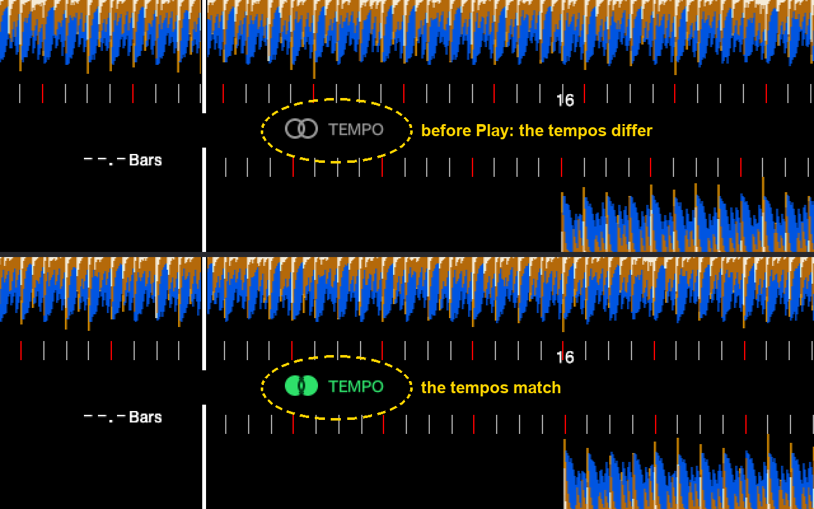
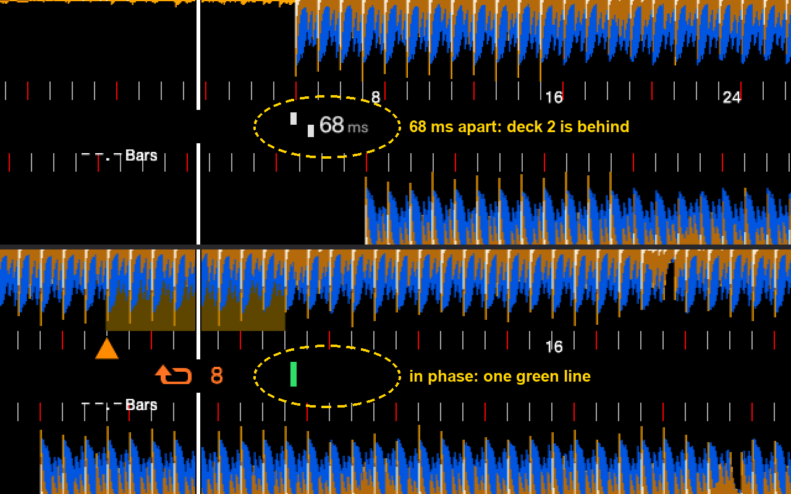

# Nudge Indicator

**Beatmatching by hand? See whether the tempos match before you press Play, then the last few
milliseconds.**

An [AZ-MODS](https://github.com/Kyle-Hosman/xdj-az-mods) community mod for the XDJ-AZ.

A small sign on the 2 DECK waveform view, between the two waveforms. It shows one of two things.

## Before you press Play: do the tempos match?

As soon as decks 1 and 2 both have a track, the sign shows a symbol of two circles and the word
TEMPO:

- **Grey**: the two tempos differ. The new track is not matched yet.
- **Green**: the tempos match, to within 0.05 BPM: the same number on both BPM displays.

So you see it while the next track still waits on Cue, not after you have started it. The symbol
also comes back, grey, when you move a tempo fader while both decks play.

Half or double tempo (64 against 128) does not count as a match.

## While both decks play: how far apart are the beats?

Once both decks play at the same tempo, the symbol gives way to the reading:

- **Two ticks.** The upper one is deck 1 and stays put. The lower one is deck 2: it sits to the
  right when deck 2 is behind, to the left when it is ahead, 1 px per millisecond (up to 14 px).
- **A number.** The difference in milliseconds.
- **A green line.** Nudge until the ticks meet. When the beats are within 5 ms of each other for a
  quarter of a second, the sign turns into one green line: the beats are where Sync would put them.

The line stays up to 5 ms and through a brief jump in the reading; it goes when the beats stay
more than 5 ms apart for a third of a second, or at once past 10 ms.

## It reads the beat grids

The reading compares the two tracks' **beat grids**, exactly what Sync works from. It does not listen
to the music. So it is only as accurate as the rekordbox analysis of both tracks:

- with good grids, the green line means the beats are together;
- where a grid is off (a wrong first beat, a drifting tempo, a live drummer), the line can show
  while the beats are audibly apart, the same way Sync would land them wrong.

Trust your ears first; fix the grid in rekordbox if the sign and your ears disagree.

## With the Phase Meter

The sign works with or without the core's Phase Meter. With the Phase Meter on, it moves beside
the meter's rulers by itself: the meter shows the picture, Nudge Indicator the number and the
tempo symbol.

## When it shows

Anything at all:

- on the 2 DECK waveform view, themes off, decks 3 and 4 empty;
- decks 1 and 2 both loaded, with a known tempo.

The reading instead of the symbol:

- both decks playing, with a beat grid;
- the two tempos within 0.2 % of each other. A larger mismatch brings the grey symbol back after
  2 seconds, so a jog nudge does not blink the reading away.

It compares beats, not bars, as Sync does.

When you leave the waveform view for Browse or a playlist, the sign can stay on screen for a
moment before it goes.

## Mod Menu

- **Nudge Indicator**: on or off.
- **Status**: what the mod sees, live: each deck's state, tempo and beat phase, whether the
  tempos match, the difference, and why the decks are not in phase.

## Safe by design

Display only. It reads the decks' beat phase and tempo through the core's services and draws one
small box. No hooks, no files, no network, no threads of its own, and it never touches a button,
a knob or the audio.

The pictures are 2x enlargements of the deck program's own screen.

## Build and test

`make unit` and `make unit-tsan` run the unit tests on a computer (clang); `make test` runs the
SDK's harness; `azmod-pack build .` builds the mod for the deck. The SDK is expected beside this
repository (`../../az-mods-sdk`), or pass `AZ_SDK=` and `AZ_SDK_INCLUDE=`. The tempo symbol's
bitmaps are in `symbol.h`, written by `tools/make-symbol.py` (needs Pillow).

## Versions

- **1.1.0**: the tempo symbol, shown while there is no reading; the Status page shows the tempo
  of a stopped deck and whether the tempos match.
- **1.0.0**: the first release.

License: GPL-3.0-only.
